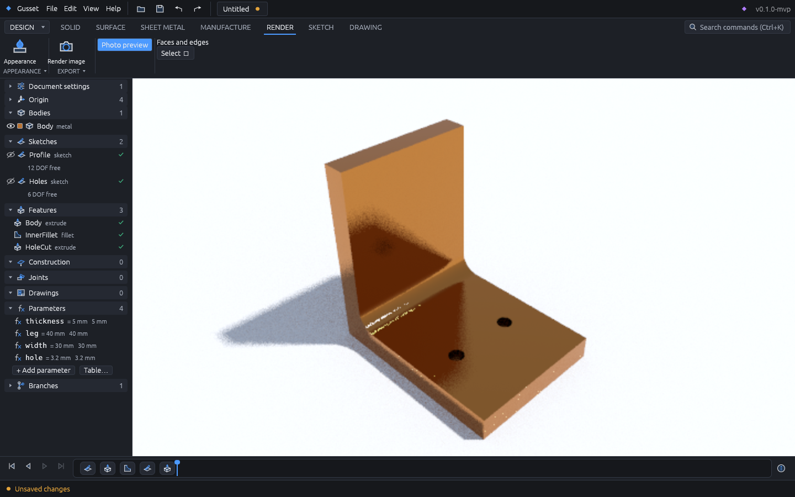

# Gusset

A Rust-native, open-source parametric 3D CAD application with a built-in MCP server,
so AI agents can do anything a human user can.

Status: in development; a pre-release (v0.1.0-mvp) is published. What is done and what
comes next: `docs/PROGRESS.md`. Architecture decisions: `docs/adr/`.

License: MIT OR Apache-2.0.



## What it does

- **Parametric modelling:** sketches with a constraint solver (degrees of freedom shown),
  extrude, revolve, sweep, loft, fillet, chamfer, shell, draft, holes and threads, text,
  mirrors and patterns, parameters with units and expressions; a code view of the whole
  model as text; generators for gears, springs, threads, nuts and bolts.
- **History you can branch:** an undo tree, branches, three-way merge, rollback, and
  history bundles to move a branch between copies of a project.
- **Assemblies:** joints (rigid, revolute, slider, cylindrical, planar, ball, pin-slot),
  components from other documents, configurations and parameter sliders, interference
  checks, a bill of materials.
- **Direct editing:** push/pull and move faces, delete faces, and a history-free mode.
- **Sheet metal, surfaces, drawings:** flanges, bends and flat patterns; surface modelling;
  2D drawings with views and dimensions, DXF/SVG export.
- **Manufacture and simulation:** 2.5D and 3D CAM toolpaths with G-code; linear static and
  modal FEA on solids and shells; topology optimisation.
- **Rendering:** body colours, finishes (plastic, metal, glass, rubber), per-face colours
  and procedural textures; a path-traced photo preview and image export.
- **Files:** STEP, IGES, STL, 3MF, OBJ, PLY, glTF, DXF/SVG; imports from Fusion 360
  (`.f3d`/`.f3z`), SolidWorks parts and assemblies (`.sldprt`, `.sldasm`), Solid Edge parts (`.par`, `.psm`), Inventor parts (`.ipt`), Parasolid (`.x_t`/`.x_b`), ACIS (`.sat`),
  FreeCAD and OpenSCAD, with names and colours kept. Imports run in a sandboxed worker.
- **Headless:** the `gusset` command line builds, exports and renders documents.

## Install

Download the package for your system from the
[Releases](https://github.com/vgyy4/CAD/releases) page (AppImage, .deb or .tar.gz on Linux; MSI
or zip on Windows; .dmg on macOS) and check it against `SHA256SUMS` if you like. Releases are
not yet code-signed (see "Code signing policy" below), so the first start shows a warning:

- **Windows:** "Windows protected your PC": click **More info → Run anyway**.
- **macOS:** "Gusset can't be opened…": right-click the app → **Open** → **Open**, or
  System Settings → Privacy & Security → **Open Anyway**.
- **Linux:** no prompt; make the AppImage executable (`chmod +x`).

Updates are checked in the app (Settings), and installed only when their Ed25519 signature
verifies.

## Code signing policy

Release packages are built and signed only by this repository's public release workflow, with
approval by the maintainer; Windows signing is planned through SignPath Foundation's free
open-source programme. The policy (what is signed, roles, privacy, revocation) and the
maintainer's set-up steps are in [docs/CODE_SIGNING.md](docs/CODE_SIGNING.md).

## Using Gusset with AI agents (MCP)

Gusset has a built-in [MCP](https://modelcontextprotocol.io) server (ADR 0012). Agents
get the same commands as the GUI, work on their own branch (`agent/<name>`), and must
get your approval for high-impact actions (set main, delete branches, editing main,
overwriting exports). Text stored in the model is returned as untrusted `user_text`.

**stdio (recommended).** `gusset mcp [file]` attaches to the running app when it has
that project open (or the most recently started app when no file is given); otherwise
it opens the file headless (a new file is created; the agent's work is saved on exit):

```sh
claude mcp add --transport stdio gusset -- gusset mcp
claude mcp add --transport stdio gusset-part -- gusset mcp /path/to/part.gus
```

Options: `--read-only` rejects every mutating tool (also when relaying to the app);
`--no-attach` always runs headless, even when the app is open;
`--tools modeling,pcb` lists more tool groups (`modeling` default, `pcb` schematic and PCB,
`sim`, `cam`; agents can also switch with the `toolset` tool, and `commands`/`run` reach every
command whatever is listed). Headless, `render_view`
renders with the GPU (any adapter, including software Vulkan/GL) or a built-in CPU
rasterizer, so it always returns a PNG. Diagnostics go to stderr; stdout carries only
the protocol.

**HTTP, directly to the running app.** The app listens on `127.0.0.1` only, on a
random port, and requires a bearer token. Both are shown in the app's "Connect an
agent" dialog and stored in an owner-only connection file:

```sh
claude mcp add --transport http gusset http://127.0.0.1:<port>/mcp \
  --header "Authorization: Bearer <token>"
```

The app can revoke the token at once (kill switch) and switch agents to read-only mode.
Agents never get shell, network or settings access, and file commands stay inside the
project folder. Read `gusset://project/security-guidelines` for the rules agents follow.

## Heavy or impossible operations

The geometry kernel runs in its own sandboxed process (`gusset-kernel-worker`, ADR 0022)
with a memory budget of 3/4 of your RAM. When an operation is too heavy for the machine,
or the kernel crashes on it, only that feature fails, with the reason (for example "the
geometry kernel crashed while building Fillet1 (segmentation fault)" or "ran out of
memory"); the app stays open and the rest of the model is rebuilt. A feature that crashed
is not tried again until you change it or something before it.

While a rebuild runs, the status bar names the feature being built and offers **Stop**,
which ends even an operation that would never finish. Agents get the same protection:
an MCP request that runs longer than 5 minutes is stopped and undone, with a
`deadline_exceeded` error. `gusset self-test` reports whether the kernel runs in its
worker process; `GUSSET_KERNEL_IN_PROCESS=1` runs it inside the app instead (for
debugging; then a kernel crash closes the app).
